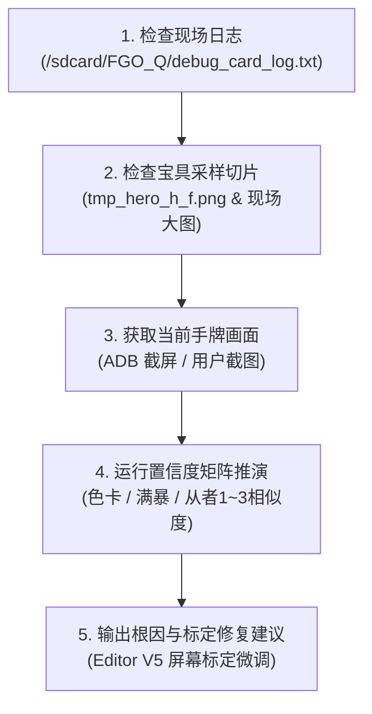

# FGO 战斗选卡与从者识别排查技能 (Card Selection & Servant Recognition Diagnoser)

用于系统化排查 FGO 战斗中**选卡失误、点错卡牌、从者识别失败、100% 暴击卡漏选或安全停机**的标准化诊断技能。

无论用户是提供运行日志、模拟器当前画面、手工截图，还是要求 Agent 自主抓取现场排查，均遵循本技能规定的排查流程与工程工具。

---

## 一、 快速排查命令行 (`scripts/diagnose_battle_cards.py`)

技能内置了一键诊断脚本：[diagnose_battle_cards.py](./scripts/diagnose_battle_cards.py)。

### 1. 模拟器在线时：一键全自动拉取现场与诊断
```bash
python .agents/skills/fgo-card-diagnoser/scripts/diagnose_battle_cards.py [--dsl "<当前出牌DSL>"]
```
* **自动行为**：
  1. 通过 ADB 连接模拟器，拉取 `/sdcard/FGO_Q/debug_card_log.txt`；
  2. 拉取 `/sdcard/FGO_Q/images/tmp_hero_*.png`（三位从者的多帧动态采样切片）；
  3. 截取当前模拟器画面（或拉取 `debug_sample_hero_screen.png`）；
  4. 自动运行 OpenCV 色卡检测、100% 满暴检测与从者 1~3 模板匹配矩阵；
  5. 生成带标注框的诊断合成图 `scratch/card_diagnosis/diagnosis_overlay.png`；
  6. 模拟 DSL 决策推演并输出根因。

### 2. 用户提供本地截屏 / 离线报错分析
当模拟器未开启或用户直接提供了截屏文件（如上传到聊天界面或存放在 `scratch/`）：
```bash
python .agents/skills/fgo-card-diagnoser/scripts/diagnose_battle_cards.py --screen "<图片路径>" [--dsl "<出牌DSL>"]
```

---

## 二、 标准排查五步法 (Standard Diagnostic Workflow)



### 第一步：排查现场执行日志 (Debug Card Log)

日志文件位置：`/sdcard/FGO_Q/debug_card_log.txt`

* **手牌识别汇总行**：
  ```text
  2026-10-21 07:42:01 Detected Hand: C1=[Q,crit=1] C2=[B,crit=1] C3=[B,crit=0] C4=[B,crit=0] C5=[B,crit=1]
  ```
  - 核对手牌 1~5 的色卡类型（`B`=Buster, `A`=Arts, `Q`=Quick）是否与画面完全一致；
  - 核对带有 `crit=1` 的卡位是否准确对应画面上的 100% 暴击卡。
* **规则命中或终止行**：
  - 命中成功：`Matched Priority Atom [H1!] at Card 1 (Crit100=1)`
  - 安全停机：`ABORT: 选卡未命中优先级 [H3>A>B>Q>H2>H1] 兜底保护，安全停机`

### 第二步：排查宝具卡头像采样切片 (Sampled NP Face Crops)

切片文件位置：`/sdcard/FGO_Q/images/tmp_hero_{heroId}_{frameIdx}.png`
* **正常切片规格**：
  - 尺寸必须为 **40×20** 左右的横向长方形（宽大于高）；
  - 内容必须严格居中在**双眼与鼻梁面部纯净区**；
* **常见异常形态**：
  - **切片近乎纯白/泛白（过曝）**：撞上了宝具卡 1.0 秒正弦脉冲流光的波峰极大值；
  - **切片包含发顶/血条/状态 Buff**：采样区域偏上（$y < 180$）；
  - **切片包含宝具名大字艺术字**：采样区域偏下（$y > 218$）；
  - **切片为近似正方形（如 40×35）**：纵向跨度过大，极易吃进流光与反光。

### 第三步：核验手牌立绘匹配置信度矩阵 (Servant Matching Matrix)

运行 [diagnose_battle_cards.py](./scripts/diagnose_battle_cards.py) 生成置信度推演矩阵：

| 卡位 | 色卡 | 100%满暴 | 从者1相似度 | 从者2相似度 | 从者3相似度 | 判定结论 |
| :---: | :---: | :---: | :---: | :---: | :---: | :---: |
| Card 1 | B | ★ 100% (0.99) | **0.984** | 0.724 | 0.500 | H1 (✔命中) |
| Card 2 | Q | ★ 100% (0.80) | 0.578 | **0.691** | 0.464 | H2 (?低信未达0.75) |
| Card 4 | B | 否 (0.65) | 0.556 | 0.575 | **0.891** | H3 (✔命中) |

* **相似度判定准则**：
  - **$\ge 0.75$**：高确信度命中（正常匹配在 0.83~0.98 之间）；
  - **$0.55 \sim 0.74$**：低置信度（疑似目标从者，但受偏色、光效或标定框轻微偏移影响未达门槛）；
  - **$< 0.53$**：非该从者卡牌。

### 第四步：核验 100% 满暴击率识别

* **百位数专属区**：必须严格限定在手牌点击中心 $cx - 55 \sim cx - 35$ 狭窄区间（1440x810 下宽约 20px）；
* **模板双候选**：全字模板 `BATTLE_ATTACK_CARD_100.png` + 直笔核心 `BATTLE_ATTACK_CARD_100_2.png`；
* **偏色容差**：找色偏色容差必须设为 `"202020"`（容许约 32 阶 RGB 抖动，兼容红卡暖色羽化与蓝卡冷色羽化）。

---

## 三、 根因分类与修复指南 (Root Cause & Remediation)

### 故障 1：手牌从者相似度在 0.60~0.74 徘徊，未达到 0.75 导致跳过或停机
* **根因**：宝具卡采样切片框偏离了五官核心，或者手牌立绘识别区域偏高吃进了卡牌上沿的银色金属饰条（$y < 480$）。
* **修复方法**：
  1. 打开 Editor V5 屏幕标定；
  2. 切换到「战斗」分类，选中对应的 `BATTLE_HERO_NP_FACE_{h}`；
  3. 将 40×20 框精准对齐到从者的双眼与鼻梁，避开额头高光；
  4. 点击「💾 保存选区配置并推送」。

### 故障 2：找图匹配度全员低于 0.10（全灭漏选）
* **根因**：按键精灵脚本中的 `HERO_CARD_OFFSET_COLOR` 被误设为 `"000000"`（绝对零容差），导致抗锯齿平滑后的像素全部判定为不匹配。
* **修复方法**：
  - 确认 `battle_v5_config.q` 与 `battle_v5_runner.q` 中的 `HERO_CARD_OFFSET_COLOR` 保持为 `"202020"`。

### 故障 3：非 100% 卡片被误判为 100% 满暴
* **根因**：暴击率搜图范围过宽（伸入了 $cx - 25$ 以内），十位数的数字笔画（如 40% 的 '4' 右竖笔、60% 的 '6' 竖弧）被直笔模板误匹配。
* **修复方法**：
  - 检查 Editor V5 中 `BATTLE_CRIT_100_AREA_{i}` 的右边界，严格将其约束在 $cx - 35$ 之前。

---

## 四、 规则与严禁项

> [!CAUTION]
> **严格遵循出卡配置，严禁建议随意兜底**：
> 若用户的出牌配置（DSL）中未设置兜底条件（如未加 `*`），说明该关卡必须严格按照配置出牌，出牌偏差极易导致连发断档或战败翻车。未命中时安全停机属于符合预期的保护行为。**严禁向用户提供“加兜底/随便出一张”等妥协性方案**，排查与解决重心必须放在从根本上解决识别率问题。
