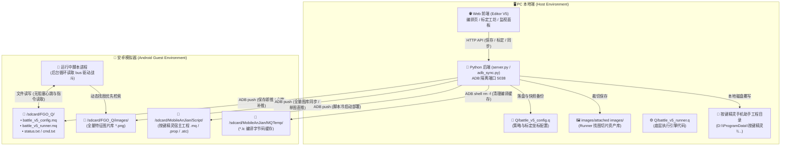
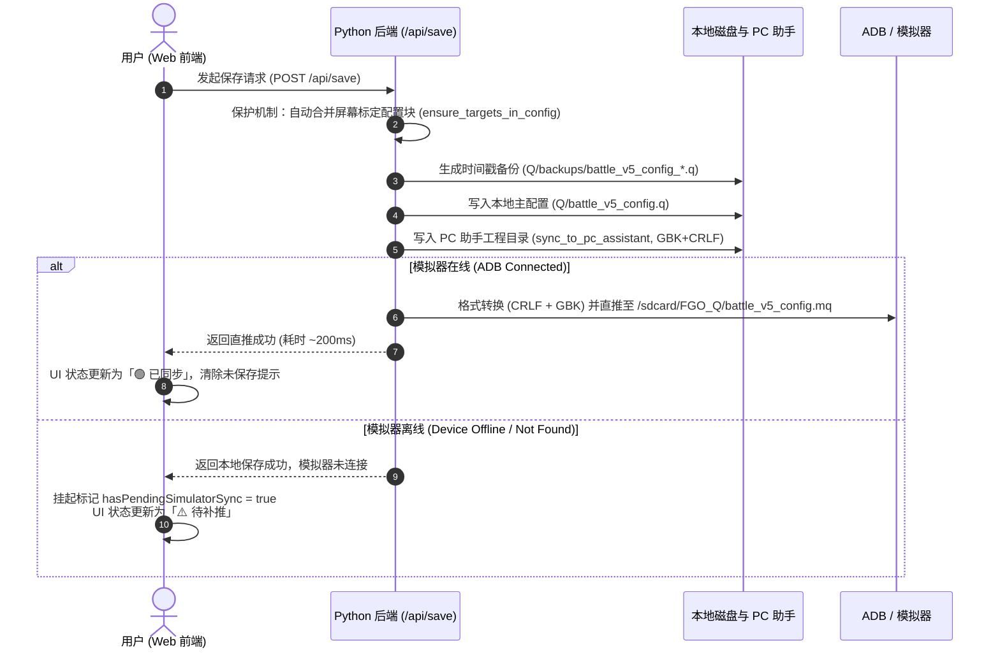
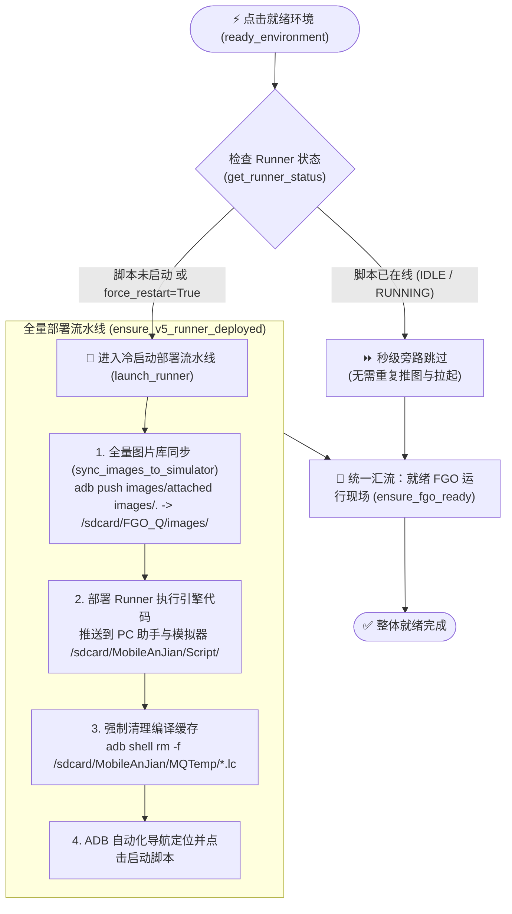
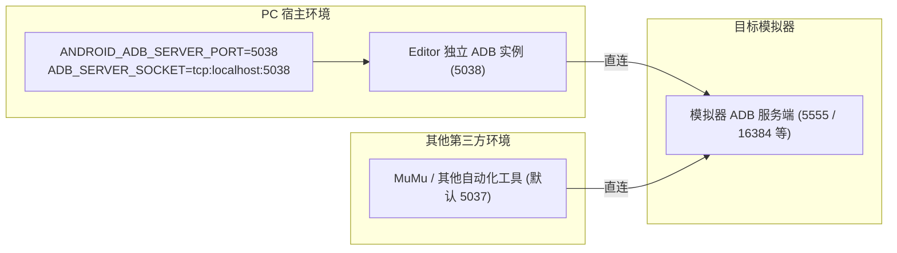

# Editor V5 数据同步机制与架构设计规范

本文档系统梳理 **FGO_Q Editor V5** 的全链路同步机制，涵盖 PC 本地工程、Python 后端服务、Web 前端界面、PC 手机助手以及安卓模拟器运行时之间的文件传输、状态探测、差异补推与异常保护设计。

---

## 1. 架构总览与拓扑图

Editor V5 采用 **“本地仓库为绝对基准、ADB 直推为物理通道、独立目录为通信总线”** 的轻量热更架构。通过将高频配置、图像资产与静态执行引擎解耦，消除了反复重新打包 `.atc` 附件与按键精灵编译工程的成本。



---

## 2. 核心同步资产矩阵

### 2.1 资产基础映射与物理路径

| 资产分类 | 本地源文件 | 模拟器目标路径 | PC 助手同步路径 | 编码与格式规范 | 在线同步策略 |
| :--- | :--- | :--- | :--- | :--- | :--- |
| **战术编排策略配置** | `Q/battle_v5_config.q` | `/sdcard/FGO_Q/battle_v5_config.mq` | PC 助手 Script 目录 `.mq` | GBK + CRLF | **保存即推 (Push on Save)** |
| **视觉标定坐标** | `editor_v5/profiles/default_1440x810.json`<br>`Q/battle_v5_config.q` | `/sdcard/FGO_Q/battle_v5_config.mq` | PC 助手 Script 目录 `.mq` | JSON (UTF-8)<br>Q 代码 (GBK + CRLF) | **标定保存双向同步** |
| **视觉特征图资产** | `images/attached images/*.png` | `/sdcard/FGO_Q/images/*.png` | 历史备用 `.atc` (选填) | PNG 格式 (无损) | **单图保存直推** |
| **执行引擎 Runner** | `Q/battle_v5_runner.q` | `/sdcard/MobileAnJian/Script/`<br>`/sdcard/FGO_Q/battle_v5_runner.mq` | PC 助手 Script 目录 | GBK + CRLF | **按需差量部署** |
| **运行控制与总线** | 前端控制动作 (Run/Stop/Extra) | `/sdcard/FGO_Q/cmd.txt`<br>`/sdcard/FGO_Q/status.txt` | 无 | UTF-8 / GBK 文本 | **无阻塞指令下发** |

### 2.2 离线表现与开机补同步对照表

下表详细定义了**当安卓模拟器未启动/离线时**各项资产的表现，以及后续**模拟器开机上线后**系统的自动补偿机制与手动补推方式：

| 资产分类 | 模拟器在线时表现 (保存即推) | 模拟器未开时表现 (离线行为) | 后续开机后补同步机制 (上线补偿) | 补偿性质与生效时机 |
| :--- | :--- | :--- | :--- | :--- |
| **战术编排策略配置**<br>(`battle_v5_config.mq`) | 按 `Ctrl + S` 或点击保存后约 **200ms 内直推** 至模拟器，顶栏状态显示 `🟢 已同步`。 | • 本地代码 `Q/battle_v5_config.q` 正常落盘并生成备份；<br>• PC 助手工程目录正常覆写；<br>• 跳过 ADB 推送，前端挂起 `hasPendingSimulatorSync = true`，顶栏状态转为 `⚠️ 待补推`。 | **1.【全自动】10 秒心跳补推**：模拟器开机连线后，前端轻量心跳监测到设备在线，自动静默触发 `/api/sync` 直推到位，弹窗提示；<br>**2.【全自动】运行前保底强推**：点击「▶ 运行战斗」发令前，后端强制自动下发最新配置；<br>**3.【手动】**：随时点击顶栏 ADB 状态胶囊手动补推。 | **全自动**<br>(开机后 0~10s 内静默补推，或点击运行瞬间保底) |
| **视觉标定坐标**<br>(`default_1440x810.json` + `Q` 代码) | 在标定工坊保存选区后，双向写入本地 JSON 与 Q 代码块，并直推更新模拟器配置文件。 | • 本地 JSON Profile 与 `Q/battle_v5_config.q` 正常落盘；<br>• PC 助手工程正常覆写；<br>• 跳过模拟器 ADB 推送（`pushed_to_emulator = false`），不会报错崩溃。 | **1.【全自动】心跳补推**：若在编排页触发过保存，随 10 秒心跳自动补推；或点击「▶ 运行战斗」时发令前强制覆写；<br>**2.【手动】工坊重推**：模拟器开机后，在标定工坊针对该目标重新点击一次「💾 保存选区配置并推送」；<br>**3.【手动】**：点击顶栏 ADB 状态胶囊手动同步。 | **自动 / 一键手动**<br>(保存即推或工坊一键补推) |
| **视觉特征图资产**<br>(`images/attached images/*.png`) | 标定保存时，单张图片通过 `adb push` 毫秒级直推到模拟器 `/sdcard/FGO_Q/images/<fname>.png`。 | • 截图从画布已有画面或外部导入正常裁切并落盘至本地代码库；<br>• 跳过模拟器图片推送（模拟器 `/sdcard/FGO_Q/images/` 暂未写入新图）。 | **1.【全自动】就绪环境全量补推**：模拟器开机后，点击「⚡ 就绪环境」（冷启动阶段），系统自动调用 `sync_images_to_simulator()`，将本地仓库所有图片全量推送到模拟器；<br>**2.【手动】工坊单图直推**：模拟器开机后，在标定工坊点击对应目标的「💾 保存选区配置并推送」，检测到连线后单独毫秒级直推该图。 | **冷启动全自动 / 单图手动**<br>(点就绪环境时全量覆盖，或工坊单图直推) |
| **执行引擎 Runner**<br>(`battle_v5_runner.mq`) | 版本稳定常驻后台待命（`IDLE` 状态）。改动代码后需冷启动部署。 | • 本地源码正常保存于 `Q/battle_v5_runner.q`；<br>• PC 助手工程正常同步写入；<br>• 模拟器部署跳过。 | **【全自动】冷启动 MD5 差量部署**：模拟器开机后，点击「⚡ 就绪环境」，系统自动计算本地源码编译后的 MD5 哈希与模拟器端 `md5sum` 进行比对，检测到哈希不一致或缺失时全量部署 `.mq` / `.prop` / `.uis` / `.atc` 到 `/sdcard/MobileAnJian/Script/`，并强制清理 `MQTemp/*.lc` 编译缓存后启动。 | **冷启动全自动**<br>(点击「⚡ 就绪环境」时全自动完成部署与清理) |
| **运行控制与总线**<br>(`cmd.txt` / `status.txt`) | 前端点击运行/停止，毫秒级无阻塞写入 `/sdcard/FGO_Q/cmd.txt`；脚本通过 `status.txt` 1 秒心跳上报。 | • 顶栏显示 `📱 离线`；<br>• 前端点击「运行战斗」直接提示“未检测到在线安卓模拟器”，指令被拦截保护，防止空发或脏状态。 | **【就绪恢复】**：模拟器开机后点击「⚡ 就绪环境」，游戏与按键脚本拉起待命后，总线通信通道自动恢复，点击运行即可即时生效。 | **就绪后即时恢复** |


---

## 3. 详细同步触发场景与工作流

### 3.1 场景一：战术编排页保存（保存即推 vs 离线挂起）

当用户在编排控制台点击「💾 保存配置」或按下快捷键 `Ctrl + S` 时触发：



### 3.2 场景二：10 秒轻量心跳监测与离线自动补推

为了消除用户在模拟器未开机时保存配置后的后顾之忧，前端建立了自动化轻量心跳观测器：

1. **高频轮询**：前端通过 [`startAdbAutoWatcher`](file:///f:/2nd%20Accra/Git/Github/FGO_Q/editor_v5/js/api.js#L555-L563) 每隔 10 秒请求一次 `/api/adb/status`。
2. **状态变迁检测**：
   * 若当前设备状态从“离线”恢复为“在线”，且前端存在未同步标记 `hasPendingSimulatorSync === true`；
   * 前端全自动触发静默补推（调用 `POST /api/sync`，携带本地最新编排配置）；
   * 后端完成推送到模拟器 `/sdcard/FGO_Q/battle_v5_config.mq` 并返回成功；
   * 前端消费掉待补推标记，弹出 Toast 提示：`⚡ 模拟器已连接，已自动补推未同步的配置`，状态更新为 `✅ 已同步`。
3. **安全防线（不盲推草稿）**：
   * 若用户仅在页面临时修改了卡牌顺序但**从未点击保存**，`hasPendingSimulatorSync` 保持为 `false`，心跳检测即使发现连线也不会推送半成品草稿，确保当前正在运行的脚本不受干扰。

### 3.3 场景三：屏幕标定工坊保存（选区裁切与单图热更）

在屏幕标定工坊中框选目标、点击「💾 保存选区配置并推送」或微调点击锚点时触发：

1. **画面获取与裁切**：
   * 若传入了画布画面，后端从前端提供的 `image_base64`（或 ADB 截屏）中裁切目标区域；
   * 保存并覆写至本地仓库：`images/attached images/<target_file>.png` 以及 `images/editor/<target_file>.png`。
2. **双套坐标持久化**：
   * 将裁切范围（`crop_rect`）、运行时搜图范围（`search_area`）、点击锚点（`tap_coord`）写入 `editor_v5/profiles/default_1440x810.json`；
   * 调用 `sync_target_to_config_file`，自动定位并重写 `Q/battle_v5_config.q` 中的目标坐标声明语句（如 `BATTLE_ROUND_3_3_TAR = Array(...)`）。
3. **单图与配置保存直推**：
   * 若此时模拟器在线：
     1. 单张图片直推：`adb push <saved_path> /sdcard/FGO_Q/images/<target_file>.png`（无需全量推送所有图片，毫秒级响应）；
     2. 配置直推：同步将更新后的 `battle_v5_config.mq` 直推至模拟器 `/sdcard/FGO_Q/`；
   * 若此时模拟器离线：
     * 本地数据均已安全落盘，跳过 ADB 推送，不会抛出致命异常。

### 3.4 场景四：一键「⚡ 就绪环境」与全量资源部署

点击顶栏的「⚡ 就绪环境」启动流水线时，系统依据按键脚本的活性状态智能分流：



> [!IMPORTANT]
> **关键设计原则**：
> * **冷启动时全量同步**：在脚本未启动（刚开模拟器）时，点就绪环境会自动把本地所有最新图片同步到模拟器 `/sdcard/FGO_Q/images/`，补齐离线期间新增的所有特征图。
> * **待命状态防干扰**：脚本已经在后台待命时，跳过图片全量同步与进程重载，实现**零触碰、秒级极速就绪**。

### 3.5 场景五：点击「▶ 运行战斗」执行前强制保底同步

在编排页面点击「▶ 运行战斗」时：
* 后端收到运行请求（`/api/runner/start` 或 `/api/run`）；
* 在向模拟器下发 `START_BATTLE` 通信指令之前，后端**无条件强制执行一次 `push_config_to_simulator`**；
* 将前端当前的最新策略配置直推并覆写至模拟器 `/sdcard/FGO_Q/battle_v5_config.mq`；
* 即使先前离线心跳未触发或未手动保存，也能 100% 确保模拟器在开始战斗的一瞬间执行的是最新配置。

---

## 4. 格式规范与数据完整性保障

### 4.1 编码规范：强制 GBK + CRLF

按键精灵手机助手及其 Android 端解释器内核对文本格式有严格要求：
* **换行符**：必须为 Windows 风格的 `\r\n` (CRLF)。若使用 Linux 风格的 `\n` (LF)，按键精灵在解析多行逻辑或注释时可能发生行号错乱；
* **字符集**：必须使用中文 `GBK` 编码写入模拟器。若使用 `UTF-8` 编码，按键脚本在读取包含中文字符的配置（如助战名、策略注释等）时会出现乱码，导致匹配失效。
* **实现封装**：后端在 [`push_config_to_simulator`](file:///f:/2nd%20Accra/Git/Github/FGO_Q/editor_v5/adb_sync.py#L1043-L1054) 中对所有下发的配置文本强制做统一归一化转换：
  ```python
  normalized_text = config_text.replace("\r\n", "\n").replace("\r", "\n").replace("\n", "\r\n")
  gbk_bytes = normalized_text.encode("gbk", errors="replace")
  ```

### 4.2 配置块防剥离机制 (`ensure_targets_in_config`)

在 Editor V5 中，`Q/battle_v5_config.q` 同时承载两部分内容：
1. **上半部分**：战术编排 DSL（队伍技能施放、换人、换面、宝具时机等）；
2. **下半部分**：屏幕标定与视觉目标数组（`' === 🎯 屏幕标定与视觉目标配置` 锚点标识）。

* **风险场景**：若用户在战术编排页修改并保存配置，前端生成的 DSL 文本可能未包含下半部分的标定代码。
* **防护设计**：后端在执行保存或同步前（`/api/save`、`/api/sync`），强制调用 [`ensure_targets_in_config()`](file:///f:/2nd%20Accra/Git/Github/FGO_Q/editor_v5/server.py#L101-L125)，自动从现有文件中提取标定块并完整拼合，彻底杜绝屏幕标定数据被意外覆写或剥离。

### 4.4 编译字节码缓存清理机制 (`*.lc`)

按键精灵在首次加载 `.mq` 脚本时，会将其预编译为二进制缓存文件（存放于 `/sdcard/MobileAnJian/MQTemp/<uuid>.lc`）。
* **潜在隐患**：如果仅通过 ADB 覆盖了 `.mq` 文件而没有清除旧的 `.lc` 缓存，按键精灵可能继续执行旧的字节码，出现“代码已改动但模拟器表现依然是旧版”的现象；
* **防护措施**：任何涉及 Runner 执行引擎代码（`battle_v5_runner.mq`）部署的操作，均自动执行 `rm -f /sdcard/MobileAnJian/MQTemp/*.lc`，强制解释器在下次启动时基于最新的 `.mq` 源码重新编译。

### 4.5 执行引擎 Runner 代码同步：基于 MD5 哈希校验机制 (Hash Verification)

* **长度判断的反模式缺陷**：
  早期版本仅依据模拟器内文件的字节总长度（`len(mq_bytes)`）判断是否需要推送。当代码修改未改变字符数时（如将常数 `33` 改为 `35`，或调整变量命名、微调逻辑），文件大小完全一致，导致系统误判跳过部署，引发“代码改了却没推送到模拟器”的严重问题；
* **双端 MD5 哈希闭环校验**：
  1. **本地端**：以标准归一化（GBK + CRLF）转换后的二进制内容计算 32 位 MD5 摘要；
  2. **模拟器端**：通过 `adb shell md5sum '<path>'` 直接调用系统底层命令获取目标脚本的实时 MD5 哈希；
  3. **严格判定**：仅当远程文件存在且双端 MD5 字符串完全一致时才判定为免推；一旦出现哪怕 1 个字符的差异、远程缺失、或显式传入 `force=True`，系统立即执行全量覆盖并主动清理 `.lc` 编译缓存，同时输出直观的哈希对比日志。

### 4.6 图像资产解耦规范

Editor V5 严格区分了两类视觉素材，避免相互污染：
* **`images/attached images/` (Runner 专属)**：
  * 用于战斗内按键脚本找图（如 `BATTLE_ATTACK_BACK.png`、从者面部切片、助战特征等）；
  * 专用于推送至模拟器 `/sdcard/FGO_Q/images/` 以及打包 `.atc`。
* **`images/editor/` (Editor 专属)**：
  * 用于 Editor V5 自身自动化流程（ADB 截图识别游戏标题、公告叉号、游玩指引、更新弹窗等）；
  * 仅在 PC 端 Python 进程中由 OpenCV 加载，不需要推送到模拟器内。

### 4.7 CLI / 脚本直推规范与设备标识注意事项

当修改了 `Q/battle_v5_runner.q` 或图像资产、需要通过命令行直接触发部署时，应按以下方式调用 [`ensure_v5_runner_deployed`](file:///f:/2nd%20Accra/Git/Github/FGO_Q/editor_v5/adb_sync.py#L2601)：

```bash
python -c "import editor_v5.adb_sync as s; print(s.ensure_v5_runner_deployed(force=True))"
```

> [!CAUTION]
> **切勿硬编码或手填 `device='emulator-5554'`**：
> * `editor_v5.adb_sync` 内部优先使用模拟器自带 ADB（如雷电 `E:\leidian\LDPlayer9\adb.exe`），其识别的设备名通常为 `127.0.0.1:5555`，与系统 `PATH` 中通用 `adb devices` 显示的 `emulator-5554` **不一致**。
> * 注意函数签名为 `ensure_v5_runner_deployed(adb=None, device=None, force=False)`：
>   1. 不可将设备名作为第一位置参数传入（会被误当作 `adb` 路径）；
>   2. 不可传入不匹配的 `device='emulator-5554'`，否则内部 `adb -s` 会因找不到对应序列号而跳过实际推送，造成“看似执行但模拟器文件时间戳未变”的假象。
> * **正确做法**：直接省略 `adb` 与 `device` 参数，仅传 `force=True`，由 `get_selected_device(adb)` 自动解析当前在线设备；推送完成后建议执行以下命令核验文件时间戳与大小是否已更新：
>   ```bash
>   adb shell "ls -la /sdcard/FGO_Q/battle_v5_runner.mq /sdcard/MobileAnJian/Script/fgo_battle_v5_runner*"
>   ```

---

## 5. 底层通信与端口隔离机制



* **端口物理隔离**：Editor V5 默认将自身 ADB 守护端口绑定至 `5038`，杜绝与其他依赖 `5037` 默认端口的工具（如 MuMu 助手、MFA 等）发生相互 `kill-server` 导致的连线震荡。
* **多模拟器智能探测**：支持雷电、MuMu、按键助手自带 ADB 的路径自动回退，并支持在 Web 顶栏通过下拉菜单即时切换不同的模拟器实例。

---

## 6. 常见同步状态与排障参考

| 状态显示 | 内部标志 | 对应状态与原因 | 推荐处置方式 |
| :--- | :--- | :--- | :--- |
| **🟢 已同步** | `hasPendingSimulatorSync = false`<br>`adb.connected = true` | 模拟器在线，最新配置已成功推送到 `/sdcard/FGO_Q/battle_v5_config.mq`。 | 正常状态，可直接运行。 |
| **⚠️ 待补推** | `hasPendingSimulatorSync = true`<br>`adb.connected = false` | 本地已保存落盘，但保存时模拟器未连接。 | 启动模拟器后，等待 10 秒心跳自动补推，或点击一次「⚡ 就绪环境」。 |
| **📱 离线** | `adb.connected = false` | 未找到在线模拟器实例或端口未通。 | 检查模拟器是否启动，或点击顶栏指示器重新检测。 |
| **图片未更新** | 模拟器内依然匹配旧图 | 标定后模拟器未处于连线状态，或图片未同步至 `/sdcard/FGO_Q/images/`。 | 确保模拟器在线，点击顶栏「⚡ 就绪环境」（若脚本未运行）或在标定页重新点一次「保存选区配置并推送」。 |
| **代码未生效** | 修改 Runner 后模拟器表现无变化 | 模拟器内存在旧的 `.lc` 编译缓存或常驻进程未重启。 | 在顶栏勾选“强制重启”并点击「⚡ 就绪环境」，系统会自动杀死旧进程、清理 `.lc` 并重新编译。 |
